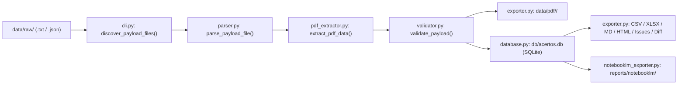

# Arquitetura e Funcionamento — Conferência de Acertos

Este documento descreve a arquitetura técnica, a stack utilizada, o fluxo de dados e as regras de negócio aplicadas na conferência da interface **MTech → AgroCenter → Produtor**.

---

## 1. Fluxo de Dados (End-to-End)

### Ciclo de Execução (`run_pipeline`)
1. **Descoberta (`cli.py`):** `discover_payload_files()` varre `data/raw/` recursivamente (`rglob`) procurando `.txt` e `.json`.
2. **Parsing do Contrato (`parser.py`):**
   - Lê com fallback de encoding (`utf-8-sig` → `latin-1`).
   - Valida o envelope JSON (`Schema` em `SUPPORTED_SCHEMAS`, lista `Data` não vazia) e cada item via `DemaisDadosModel` (Pydantic v2 com `ConfigDict(extra="allow")` e validação de `BrimGrowSettlementsIRN` não vazio).
   - Decodifica `PDF64` em Base64 estrito e valida assinatura `%PDF`.
3. **Extração Estruturada do PDF (`pdf_extractor.py`):**
   - Valida abertura estrita com `pypdf.PdfReader(..., strict=True)`.
   - Extrai texto com `pdfplumber` (`layout=True`) e calcula 3 hashes: `pdf_bytes_sha256`, `pdf_texto_sha256` e `pdf_texto_canonico_sha256` (linhas normalizadas e ordenadas para detectar reordenação não determinística de tabelas).
   - Extrai cabeçalho, `BP` em todas as páginas, Termo de Quitação, indicadores zootécnicos e valores financeiros (suportando separadores PT-BR e EN-US).
4. **Motor de Validação (`validator.py`):** executa as regras de contrato, LGPD, batimento JSON × PDF, localização e consistência zootécnica/financeira.
5. **Persistência & Sincronização (`database.py` + `cli.py`):**
   - Faz *upsert* em `db/acertos.db` e remove registros órfãos de arquivos excluídos de `data/raw/` (preservando arquivos que falharam por exceção inesperada).
6. **Geração de Artefatos (`exporter.py` + `notebooklm_exporter.py`):**
   - Cria dossiês individuais em `data/pdf/<safe_stem>/` (`PDF`, `payload.json`, `relatorio_acuracia.md`).
   - Exporta planilhas (`conferencia_acertos.xlsx`, CSVs), relatórios (`relatorio_homologacao.md`, `relatorio_homologacao.html`), pacote de issues (`issues_dev.md`, `issues_dev.csv`), diff de duplicidades (`diff_duplicidades.md`) e fontes para NotebookLM.

---

## 2. Módulos e Responsabilidades

| Módulo | Responsabilidade Principal |
| :--- | :--- |
| [cli.py](file:///home/bruno/Documentos/1_C.VALE/2%20-%20PROJETOS/13%20-%20ConferenciaAcertos/src/conferencia_acertos/cli.py) | Orquestração da CLI (`run`), descoberta recursiva, isolamento de falhas por arquivo e sincronização de órfãos |
| [parser.py](file:///home/bruno/Documentos/1_C.VALE/2%20-%20PROJETOS/13%20-%20ConferenciaAcertos/src/conferencia_acertos/parser.py) | Leitura resiliente, validação Pydantic de `Demais_Dados`, decomposição de `Numero_Extrato` e decode de `PDF64` |
| [pdf_extractor.py](file:///home/bruno/Documentos/1_C.VALE/2%20-%20PROJETOS/13%20-%20ConferenciaAcertos/src/conferencia_acertos/pdf_extractor.py) | Validação estrutural (`pypdf`), extração posicional (`pdfplumber`), parsing numérico PT-BR/EN-US e hashes |
| [validator.py](file:///home/bruno/Documentos/1_C.VALE/2%20-%20PROJETOS/13%20-%20ConferenciaAcertos/src/conferencia_acertos/validator.py) | Regras de negócio, LGPD (`Cod_Cliente == BP`), batimento de datas/lotes e consistência zootécnica/financeira |
| [database.py](file:///home/bruno/Documentos/1_C.VALE/2%20-%20PROJETOS/13%20-%20ConferenciaAcertos/src/conferencia_acertos/database.py) | DDL SQLite, *upsert* transacional e views analíticas (`vw_conferencia_completa`, `vw_divergencias`, `vw_duplicidades_lote`) |
| [exporter.py](file:///home/bruno/Documentos/1_C.VALE/2%20-%20PROJETOS/13%20-%20ConferenciaAcertos/src/conferencia_acertos/exporter.py) | Dossiês por payload, CSV/XLSX, relatórios executivos MD/HTML, issues para Dev e diff de PDFs duplicados |
| [notebooklm_exporter.py](file:///home/bruno/Documentos/1_C.VALE/2%20-%20PROJETOS/13%20-%20ConferenciaAcertos/src/conferencia_acertos/notebooklm_exporter.py) | Pacote de fontes Markdown, datasets CSV e prompts prontos para análise no NotebookLM |

---

## 3. Modelo de Dados SQLite (`db/acertos.db`)

- **Tabelas:**
  - `payloads`: metadados do arquivo, hashes (`sha256_arquivo`, `pdf_bytes_sha256`, `pdf_texto_canonico_sha256`), `cod_cliente`, validade do PDF.
  - `acertos_json`: campos de `Demais_Dados` (`cod_empresa`, `lote`, `data_emissao`, `aviario`, `numero_extrato`, `brim_grow_settlements_irn`).
  - `acertos_pdf`: dados extraídos do demonstrativo (`produtor`, `bp`, `bps_encontrados`, `aviario_codigo`, `lote_pdf`, `quitacao_*`, indicadores zootécnicos e valores financeiros).
  - `validacoes`: resultado de cada regra (`regra`, `status`, `severidade`, `valor_json`, `valor_pdf`, `detalhe`).
- **Views para DBeaver:**
  - `vw_conferencia_completa`: visão consolidada 1 linha por payload + `status_homologacao` (`APROVADO`, `APROVADO_COM_ALERTA`, `REPROVADO`).
  - `vw_divergencias`: apenas regras com status `FALHA` ou `ALERTA`, ordenadas por severidade.
  - `vw_duplicidades_lote`: agrupamento por `aviario-lote` comparando `qtd_payloads`, `qtd_irns_distintos`, `qtd_hashes_pdf_binario_distintos` e `qtd_hashes_conteudo_canonico_distintos`.

---

## 4. Catálogo de Regras Conferidas

| Regra | Severidade | O que valida |
| :--- | :---: | :--- |
| `JSON_RAIZ` / `SCHEMA_VERSAO` | ALTA | JSON válido, `Data` não vazia e `Schema` em `SUPPORTED_SCHEMAS` |
| `CARDINALIDADE_1_PARA_1` | ALTA | Exatamente 1 item em `Data` correspondendo a 1 PDF válido |
| `DEMAIS_DADOS_INTEGRIDADE` | ALTA | `Demais_Dados` preenchido, contrato Pydantic e `BrimGrowSettlementsIRN` válido |
| `DEMAIS_DADOS_AVIARIO_LOTE_FORMATO` | ALTA | `Numero_Extrato` no formato `<aviario>-<lote>` consistente com `Lote` |
| `PDF_INTEGRIDADE` | ALTA | `PDF64` decodificável, assinatura `%PDF` e texto extraível |
| `BP_CONSISTENCIA_INTERNA_PDF` | ALTA | Mesmo `BP` em todas as páginas do PDF |
| `BATIMENTO_COD_CLIENTE_BP` | ALTA | **LGPD:** `Cod_Cliente` (JSON) e `BP` (PDF) presentes e rigorosamente iguais |
| `BATIMENTO_AVIARIO_PRODUTOR` | ALTA | `Aviario` (JSON) confere com `PRODUTOR` ou código `AVIÁRIO` (PDF) |
| `BATIMENTO_LOTE` / `BATIMENTO_NUMERO_EXTRATO` | ALTA | `Lote` e `Numero_Extrato` do JSON idênticos ao PDF |
| `BATIMENTO_AVIARIO_LOTE_CABECALHO` / `_QUITACAO` | ALTA | Lote composto consistente no cabeçalho (pág. 1) e no Termo de Quitação (última pág.) |
| `BATIMENTO_DATA_EMISSAO` | MEDIA | `DataEmissao` (JSON) equivalente à `DATA` (PDF) |
| `PDF_CONSISTENCIA_ZOOTECNICA` | MEDIA | `aves_abatidas <= aves_alojadas` e `mortalidade_pct + viabilidade_pct ≈ 100%` |
| `PDF_CONSISTENCIA_FINANCEIRA` | MEDIA | `valor_liquido <= valor_lote` |
| `PDF_DATA_FORMATO_EUA` | BAIXA | Alerta quando cabeçalho `DATA` está em `MM/DD/YYYY` em vez de `DD/MM/YYYY` |
| `PDF_VALOR_EXTENSO_IDIOMA` | BAIXA | Alerta quando declaração por extenso no PDF contém termos em inglês |

---

## 5. Governança com `graphify` e Agentes Locais

- **`graphifyy`:** mantém em `graphify-out/` o grafo AST do código (`graph.json`, `graph.html`, `GRAPH_REPORT.md`) para consultas rápidas de impacto e acoplamento.
- **Skills locais (`.agents/skills/`):**
  - `conferencia-acertos`: fluxo padrão de ingestão, testes e relatório.
  - `qa-analista-interfaces`: auditoria técnica de interoperabilidade, LGPD e idempotência.

---

## 6. Base de Referência `ref_aviario_bp` e Regra Proprietário × Responsável

- **Origem:** `data/cod_bp/cod_BP_integracao.md` (exportada automaticamente para `data/cod_bp/cod_BP_integracao.csv` e carregada na tabela SQLite `ref_aviario_bp` durante o `cli run`).
- **View de diagnóstico:** `vw_diagnostico_cod_cliente_bp` cruza cada divergência `Cod_Cliente != BP` com `ref_aviario_bp` via `aviario`, classificando automaticamente se há troca entre **Proprietário do Aviário (`cod_BP_Proprietario`)** e **Responsável da Granja (`cod_BP_Responsavel`)** ou divergência cadastral adicional.
